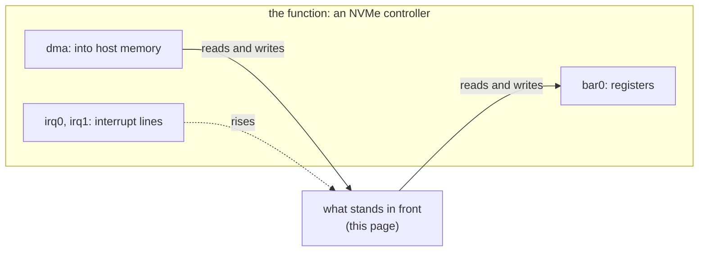
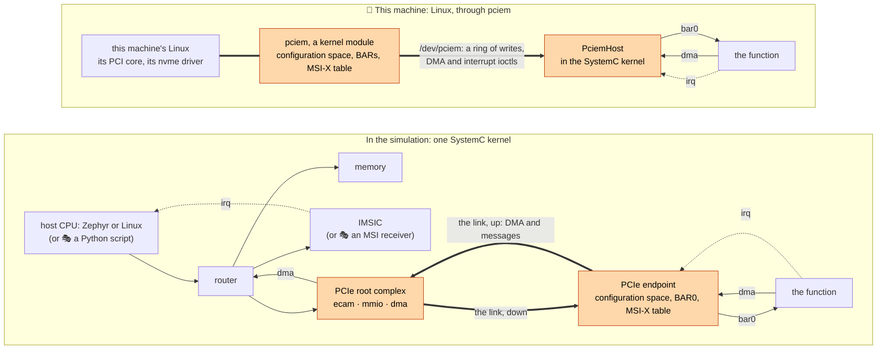
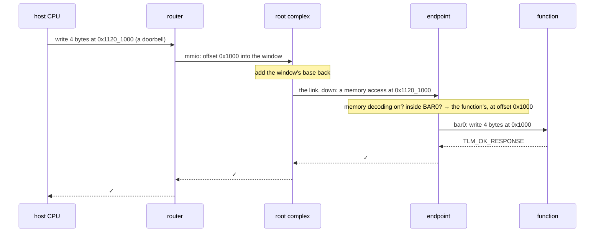
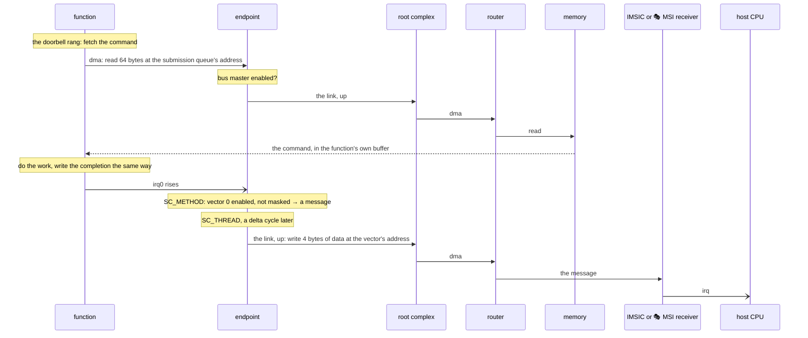
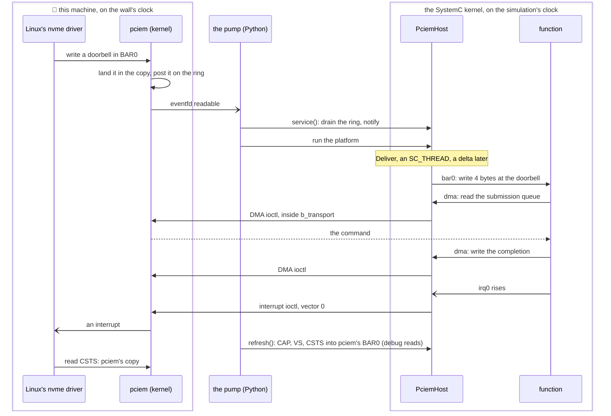

# A PCIe device and its hosts

How socpuppet models a PCIe device: what a device is to its host, how that lands on SystemC, how 🧵 Python describes and drives it, and the two ways to give the device a host, one played inside the simulation and one that is the machine you are sitting at, through pciem. Each way ends in a command you can run. The pages under [`models/`](architecture.md#the-models) take one block each; this page follows the path between them.

## To its host, a device is three things

🎓 PCIe (PCI Express) is how a computer talks to the devices plugged into it: graphics cards, network cards, NVMe drives. A device is not at a fixed address. The host finds it, asks what it is, gives it a place in memory, and only then does a driver talk to it. To that driver a device is three things:

1. **Registers at an address.** The device asks for a piece of the host's address map through a *base address register* (BAR), and the host says where the piece goes. The driver reads and writes the device's registers there.
2. **DMA.** *Direct memory access*: the device reads and writes the host's memory itself. Nobody copies a command to an NVMe drive; the drive comes and fetches it.
3. **Interrupts.** A PCIe device has no interrupt wire. It interrupts by writing a small message to an address the host chose, and something at that address turns the write into an interrupt for the CPU. This is a *message-signalled interrupt*, and *MSI-X* is the current form of it.

And one thing before any of those: 4 KiB of **configuration space**, which says who made the device (its vendor ID), which of their devices it is (its device ID) and what kind of thing it is (its class code). The host reads it to find the device and to pick a driver, and writes it to place the BAR and switch the device on.

socpuppet draws its line there. The **function** is the part that does the device's work, here an NVMe controller, and it has exactly three kinds of port: `bar0`, its register block; `dma`, its way into the host's memory; and `irq0`, `irq1`, ... one interrupt line for each *vector*, which is MSI-X's word for one interrupt the host can tell from the others. The function knows nothing of PCIe. Everything on this page is about what stands in front of those three ports.



🎓 If you have built a virtual platform of a server before, the picture may be the other way round from what you know. There the host is the subject, and a PCIe device is a stub that answers enough for the driver to come up. Here the device is the subject, and the host is the part that can be swapped: a Python script, Zephyr or Linux running on the simulated CPU, or this machine's own Linux. The function stays the same through all of them, and so do its tests.

Two functions play the drive, and both have the three ports:

- 🎭 [The behavioral NVMe](models/behavioral-nvme.md) is a **stand-in**, a simplified model that answers every command itself (queues, Identify, reads and writes), with no CPU or firmware behind it.
- [The SSD](architecture.md#the-ssd) is the real thing in small: the [NVMe frontend](models/nvme-frontend.md) keeps the queues and fetches commands, a 32-bit RISC-V CPU runs Zephyr firmware that decides what each command means, and a [DMA engine](models/dma-engine.md), a [flash controller](models/flash-controller.md) and a NAND move the data.

One contract suite, `tests/cpp/contracts/nvme_contract.h`, holds the stand-in and the SSD's hardware to what an NVMe function must do, and `tests/python/test_ssd_firmware.py` holds the Zephyr firmware to its share, so a host that works against one drive works against the other.

## Two ways to give it a host



**In the simulation**, the host's bus meets a [PCIe root complex](models/pcie-root-complex.md), which is the host's end of PCIe: two windows in the host's address map, one for configuration space and one for the device's registers, and a link down to the device. At the other end of the link a [PCIe endpoint](models/pcie-endpoint.md) wraps the function: it is the configuration space, the BAR and the MSI-X table, and it carries the function's DMA and interrupts up the link. Three hosts have stood here, and none of them changed the device:

| The host | Its firmware | What takes the interrupt messages | Where it is shown |
|---|---|---|---|
| 🎭 A Python script in the CPU's place | the script: `sp.PcieHost` finds and places the drive, `sp.NvmeHost` drives it | 🎭 [an MSI receiver](models/msi-receiver.md), one register | `examples/nvme_hello.py`, `tests/python/test_m2_exit.py` |
| The host CPU, Zephyr | Zephyr's own PCIe and NVMe drivers, with socpuppet's root complex driver | the [IMSIC](models/imsic.md), the interrupt controller RISC-V servers use | `examples/host_and_ssd_hello.py`, [boards.md](boards.md#with-a-drive) |
| The host CPU, 🐧 Linux | a stock kernel: `pci-host-ecam-generic` finds the root complex, `nvme` the drive | the IMSIC, by the devicetree's `msi-parent` | `tests/python/test_linux_nvme.py`, `tests/python/test_m24_exit.py` ([linux.md](linux.md#its-root-on-the-drive)) |

**Through pciem**, the host is the Linux you are running on. [pciem](https://github.com/cakehonolulu/pciem) is a Linux kernel module that lets a program be a PCIe device on the machine's own bus, with no virtual machine between: its kernel side plays the device's configuration space, its BARs and its MSI-X table, and hands the program the rest. [`sp.PciemHost`](models/pciem-host.md) is that program's side, inside the SystemC kernel, with the function's three ports on its other face. The endpoint, the link, the root complex and the host CPU are all gone, because Linux's PCI core, its root complex and its `nvme` driver are the real ones. The function cannot tell: `PcieEndpoint` and `PciemHost` are both a `PcieFunctionFront` in Python, with the same five parameters, and are connected to the function port for port by the same function, `connect_the_function` in `python/socpuppet/boards/drive.py`.

| | In the simulation | Through pciem |
|---|---|---|
| Who plays the host | a script, or firmware on the simulated CPU | this machine's Linux, with nothing played |
| What is modelled | root complex, link, endpoint | only the program's side of pciem |
| Time | one simulated clock for host and device | the host on the wall's clock, the device on the simulation's, kept together by the pump |
| What it needs | a `dev` build; firmware for the Zephyr and Linux hosts | a build with pciem, on Linux, with the module loaded and root for the host's commands |
| What it proves | the device against a driver, deterministically, in CI on every push | the device against a real operating system's driver, and `mkfs`, `mount` and a file written |

## How PCIe lands on SystemC

🎓 A few words first, each with its longer entry in [architecture.md](architecture.md#words-you-will-meet). In TLM-2.0, the modelling standard that ships with SystemC, blocks talk by handing each other whole *transactions* ("write these 4 bytes at this address") through function calls. A transaction leaves through an *initiator socket* and arrives at a *target socket*. The call is `b_transport`, and the same transaction can instead be sent by `transport_dbg`, the *debug transport*, which takes no simulated time and that nothing in the platform notices, the way a debugger reads memory. Code that waits runs in a *process*, an `SC_THREAD` or `SC_METHOD`, and a *delta cycle* is one round of "run everything that is ready" at a single moment of simulated time.

PCIe on SystemC comes down to one question asked three times: an access has arrived, so whose is it?

### The link is two sockets and a marker

A real PCIe link carries packets, and a packet says which of the device's address spaces it is for. That is the part a driver can observe, so it is the part kept. The link is a pair of ordinary TLM sockets, one for each direction, and a transaction on it is one of two things (`src/socpuppet/models/pcie_link.h`):

- **A memory access**: an ordinary transaction, whose address is the address on the host's bus. Going down, it is the host reading or writing the device's registers. Going up, it is the device's DMA, or an interrupt message.
- **A configuration access**: the same transaction carrying a TLM *extension*, `PcieConfigurationAccess`, a marker that rides on the payload for as long as it is on the link. Its address is an offset into the 4 KiB of configuration space.

There are no packets, lanes, training or errors, and nothing yet says which device sent an access (🚧 that arrives with the IOMMU, [roadmap.md](roadmap.md)).

### The root complex: two windows down, one way up

`PcieRootComplex` (`src/socpuppet/models/pcie_root_complex.h`) has two target sockets the host's bus maps as windows, and it decides what each access is before sending it down the link.

- **`ecam`**, the configuration window. 🎓 ECAM, the enhanced configuration access mechanism, gives every function a bus could hold 4 KiB of the window, laid out by bus, device and function number. The root complex divides the address by 4 KiB: function 0 gets its access, marked as a configuration access with the remainder as the register offset; any other slot is empty, and a read of it answers all ones with no error, which is how a host finds out what it has.
- **`mmio`**, the memory window. A bus hands a target the offset of an access into its window, and the device compares addresses on the host's bus, so the root complex adds the window's base back on before sending the access down. 💡 It learns that base from where `mmio` is mapped, through routers and links, when the platform is built, so there is nothing to tell it.
- **`from_device`**, the link coming up, goes out of **`dma`** onto the host's bus untouched. The device's DMA and its interrupt messages are both just writes and reads at host addresses, so they need no decoding here.

### The endpoint: whose address is this?

`PcieEndpoint` (`src/socpuppet/models/pcie_endpoint.h`) is a thin SystemC wrapper around `PcieEndpointRegisters` (`src/socpuppet/core/pcie_endpoint_registers.h`), which is plain C++ with no simulator in it: the configuration registers, the one 64-bit BAR, the capability list and the MSI-X table, and every decision that hangs on them. An access arriving on `from_host` goes one of two ways. A configuration access reads or writes the registers directly, and a write may change where BAR0 points or switch *memory decoding* or *bus mastering* on in the command register. A memory access is decoded against BAR0 into one of four owners:

| The access lands | And the endpoint |
|---|---|
| nowhere: memory decoding is off, or the address is outside BAR0 | answers `TLM_ADDRESS_ERROR_RESPONSE` (⚠️ a real bus answers a stray read with all ones) |
| in the function's registers, the first `function_size` bytes of BAR0 | rewrites the address as an offset and forwards the transaction out of `bar0` |
| in the MSI-X table, the page after the function's registers | reads or writes the table itself: each vector's address, data and mask |
| in the pending bits, the page after the table | reads them |

The function sees a plain bus write at an offset into its registers, as it would if it were mapped straight onto a bus with no PCIe at all, which is exactly how its own tests drive it.



### DMA: straight through, once allowed

The function's `dma` socket is bound to the endpoint's `dma` target. The endpoint looks at one bit, *bus master enable* in the command register, and either forwards the transaction up the link as it is or refuses it with `TLM_GENERIC_ERROR_RESPONSE`. 🎓 A PCIe device may do nothing to its host's memory until the host has made it a bus master. A driver that forgets the bit sees a drive that never fetches its first command, which is a lesson the project learned the slow way ([lessons.md](history/lessons.md#pcie-and-nvme)). The root complex passes the access onto the host's bus, and the router finds the memory. No bytes are copied along the way: the transaction's data pointer is the function's buffer from end to end.

### Interrupts: a wire in, a write out

Each of the function's interrupt lines is a SystemC signal, and the endpoint has an `SC_METHOD` sensitive to every line's rising edge. A rise asks the MSI-X table what to do about that vector. If MSI-X is enabled and the vector is not masked, the answer is a *message*: the address and 32 bits of data the host wrote into the table for it. If the vector is masked, the message is remembered as pending and sent when the host unmasks it. The message itself is a 32-bit little-endian write up the link, made by an `SC_THREAD` of the endpoint's own, a delta cycle after the rise.

💡 Why a thread of its own, and why a delta later? A bus access may have to wait its turn, and only a thread can wait. And the write must not start inside somebody else's access: the host's configuration write that unmasked a vector is still on the link when the endpoint learns it has a message to send. If nothing on the host's bus answers the message, the endpoint sets the *received master abort* bit in its status register, which is the one place a driver can see that its interrupts are going nowhere.

What answers the message is the host's business. 🎭 The scripted host has an MSI receiver, one register where a write of vector *n* raises its line until a read clears it. The firmware hosts have an IMSIC, the real controller for incoming messages, and Zephyr's and Linux's NVMe drivers both program the drive's table to point at it.



### Debug accesses, DMI and time

Every socket on the path answers `transport_dbg` the same way it answers `b_transport`, so `platform.peek` and a GDB attached to the host CPU see the device's configuration space through the ECAM window and its registers through the memory window, in no simulated time and with no side effects. The direct memory interface (DMI, a raw pointer to memory that lets a CPU skip the bus) does not cross the link: every access to the device goes through the sockets, where the [tracer](models/tracer.md) can see it. Nothing on the path takes any time, by the project's rule that what a block does matters and how long it takes is a tier ([vision.md](vision.md#how-choices-get-made)): a message goes out a delta cycle after its line rises, at the same simulated time, and the host CPU and the SSD's CPU share one quantum, so the order of what is said on the two consoles is good to a tenth of a millisecond.

## How pciem lands on SystemC

Here the host is outside the simulation, running on the wall's clock, and the function is inside it, running on the simulation's. `PciemHost` (`src/socpuppet/models/pciem_host.h`) and the pump (`python/socpuppet/pump.py`) are the bridge between the two.

What pciem gives the program is three things, which match the function's three ports but not one for one:

- **BAR0 as shared memory, and a ring of the host's writes to it.** When Linux's driver writes a register, pciem lands the write in its copy of BAR0 and posts it on a ring, with its offset, size and data, and an eventfd becomes readable. ⚠️ The host's *reads* never reach the program at all: Linux reads pciem's copy. So a register the function changes on its own has to be copied into that memory before the host looks. For NVMe those are three, CAP, VS and CSTS, and `PciemHost::Refresh` copies them in with debug reads, which take no simulated time, between runs.
- **An ioctl for DMA**, a copy to or from this machine's memory at the address the driver gave.
- **An ioctl for an interrupt**, which sends the host one vector.

Crossing the boundary is the whole design. Everything that comes from the host arrives outside the simulation, and anything that touches the function has to happen inside a SystemC process, so each direction has a hand-over:

- **Writes, in.** The pump sees the eventfd readable and calls `service()`, which drains the ring into a queue and notifies a SystemC event. `Deliver`, an `SC_THREAD` of the host's own, wakes a delta cycle later and makes each write on `bar0` in the order it came. A write the function refuses is counted, and the host never hears of it, as on a real bus. 🎓 Linux's `nvme` driver writes `CC`, `AQA`, `ASQ`, `ACQ` and then the doorbells, each landing on the function as a plain bus write, exactly as the endpoint would deliver it.
- **DMA, out.** The function's `dma` transaction arrives in the function's own process, and `PciemHost` makes the ioctl right there, inside `b_transport`, so the copy is done when the function's call returns. An address pciem refuses is a `TLM_GENERIC_ERROR_RESPONSE`.
- **Interrupts, out.** An `SC_METHOD` on each line's rising edge makes the interrupt ioctl. 🎓 The function's lines are *levels* and the host is sent *edges*. After a completion queue's head doorbell, NVMe asks the controller to send a new message if completions are still waiting, so `Deliver` waits one delta for the function to settle its lines and sends again each vector whose line is still high.
- **Registers, out.** At every look, `refresh()` copies CAP, VS and CSTS into pciem's BAR0.



**The pump** keeps the two clocks together. While the SSD's CPU has work, the simulation runs as fast as it can and looks at the eventfd every 10 ms of wall time. When the CPU sleeps, so that the next thing due is further off than a quantum, the pump waits on the wall with `select` on the eventfd, for as long as the sleep or one second, and then moves the simulated clock on by the wall time that passed. 🎓 QEMU's `-icount sleep=on` is the same idea. ⚠️ Linux's timeouts are on the wall: 30 s for an I/O command, 60 s for an admin one, and a drive that is not being pumped is a drive that is not answering. From `start()` until Linux's driver has let go, the platform has to be pumped, which is why the drive is unbound before the program ends.

What pciem leaves the device: one legacy interrupt, since its virtual root has no MSI domain, so every vector reaches the same line and Linux makes one I/O queue; and no link, so there is nothing for the tracer to show. The whole list, and what was sent upstream about it, is on [the component's page](models/pciem-host.md#what-it-leaves-out) and in [upstream.md](upstream.md#pciem).

## Where Python holds the strings

🧵 Python has three jobs here: it describes the platform, it can play the host, and it runs the show and watches it.

### Describing

A component is a Python object, `add` puts it in a platform, `connect` binds a port to a port and `map` puts a target socket at an address on a bus. The drive on its link is six lines (`python/socpuppet/boards/drive.py`):

```python
nvme = ssd.add("nvme", sp.BehavioralNvme(blocks=2048, vectors=2))
endpoint = ssd.add("endpoint", sp.PcieEndpoint(
    vendor_id=0x5350, device_id=0xC0DE, class_code=0x01_08_02,   # mass storage, NVMe
    function_size=sp.BehavioralNvme.mapped_size, vectors=2))
platform.connect(rc.to_device, endpoint.from_host)   # the link, down
platform.connect(endpoint.to_host, rc.from_device)   # the link, up
platform.connect(endpoint.bar0, nvme.bar0)           # the function's three ports
platform.connect(nvme.dma, endpoint.dma)
platform.connect(nvme.irq0, endpoint.irq0)
platform.connect(nvme.irq1, endpoint.irq1)
```

The root complex's windows go on the host's bus with `map`, and the up-link onto it with `connect` (`bus.map(rc.ecam, base=..., size=...)`, `bus.map(rc.mmio, ...)`, `platform.connect(rc.dma, bus.add_input())`). For the real host the same drive is described once more with nothing but the front swapped: `ssd(host=this_machine)` puts `sp.PciemHost` where the endpoint and the scripted host go, and `connect_the_function` makes the same three connections to it. `platform.build()` then elaborates it all into one SystemC kernel. ⚠️ Once, per process: the kernel cannot be restarted, and after a run it is not resting, it is an ex-kernel.

### Playing the host

A host with no CPU is a Python generator on 🎭 [`sp.ScriptedBusMaster`](models/scripted-bus-master.md): each `yield` is one bus operation, and the stand-in CPU performs it. The steps a host takes on a PCIe bus are packaged as generators too, so a script can `yield from` them ([`sp.PcieHost`](models/pcie-host.md), from `examples/nvme_hello.py`):

```python
def script():
    pci = sp.PcieHost(ecam=IO_BASE + ECAM_OFFSET)
    (drive,) = yield from pci.scan()                  # 1. enumerate: read every slot's first register
    msi = sp.MsiHost(receiver=MSI_BASE)
    yield from pci.place(drive, registers)            # 2. write BAR0, switch on decoding and bus mastering
    yield from pci.route_interrupts(drive, to=msi)    # 3. fill the MSI-X table, enable MSI-X
    nvme = sp.NvmeHost(registers=registers, memory=RAM_BASE, interrupt=msi.wait)
    yield from nvme.enable()                          # 4. only now does an NVMe driver have anything to talk to
    yield from nvme.write_blocks(first=7, data=block)
```

💡 Because each step is a generator of bus operations and nothing else, `tests/python/test_pcie.py` runs them against a dictionary standing in for configuration space, with no simulator at all, to test the rarer paths: a BAR the function cannot be at, a device with no MSI-X. The firmware hosts need none of this: Zephyr's and Linux's own PCIe code does steps 1 to 3, and the drive sees the same writes.

### Running, pumping and watching

`platform.run()` runs the simulation until nothing is left to do, which is how the scripted show ends. With a real host there is always more to do, so [`socpuppet.pump.pump`](models/pciem-host.md#what-it-does) runs it instead, with the host as a *far end*, anything with a file descriptor to wait on and `service()` and `refresh()` to call:

```python
from socpuppet.boards.real_host import this_machine
from socpuppet.boards.ssd import ssd
from socpuppet.pump import pump

board = ssd(host=this_machine, blocks=131072)      # 64 MiB
board.platform.build()
board.platform.load_elf("build/firmware/ssd_socpuppet_ssd.elf", via=board.ssd.cpu.socket)
board.host.start()                                 # on the bus: Linux binds it at once
pump(board.platform, far_ends=[board.host], until=lambda: done)
```

To watch, mark a connection `trace=True` and read `platform.trace` afterwards: `examples/nvme_hello.py` traces the up-link onto the host's bus, and counts the drive's DMA and its interrupt messages from the records. `platform.peek(address, length)` reads anything on the path with a debug access, configuration space included, which is how GDB sees the device too.

| 🧵 Python | C++ | Registry name | Page |
|---|---|---|---|
| `sp.PcieRootComplex()` | `socpuppet::PcieRootComplex` | `pcie_root_complex` | [pcie-root-complex.md](models/pcie-root-complex.md) |
| `sp.PcieEndpoint(...)` | `socpuppet::PcieEndpoint`, `PcieEndpointRegisters`, `MsixTable` | `pcie_endpoint` | [pcie-endpoint.md](models/pcie-endpoint.md) |
| `sp.PciemHost(...)` | `socpuppet::PciemHost`, `PciemDevice` | `pciem_host` | [pciem-host.md](models/pciem-host.md) |
| 🎭 `sp.BehavioralNvme(blocks=...)` | `socpuppet::BehavioralNvme`, `NvmeController` | `behavioral_nvme` | [behavioral-nvme.md](models/behavioral-nvme.md) |
| `sp.NvmeFrontend()` | `socpuppet::NvmeFrontend` | `nvme_frontend` | [nvme-frontend.md](models/nvme-frontend.md) |
| 🎭 `sp.MsiReceiver()` | `socpuppet::MsiReceiver` | `msi_receiver` | [msi-receiver.md](models/msi-receiver.md) |
| 🎭 `sp.PcieHost`, `sp.MsiHost`, `sp.NvmeHost` | none: Python generators | | [pcie-host.md](models/pcie-host.md), [nvme-host.md](models/nvme-host.md) |
| `socpuppet.pump.pump` | none: Python, calling `step` and `run` | | [pciem-host.md](models/pciem-host.md) |

## Try it

Cheapest first. Every command is run from the checkout after [setup.md](setup.md)'s build; the times are from one laptop.

| Show | The host | Needs | Takes |
|---|---|---|---|
| 1. A script finds the drive, no CPUs | 🎭 Python | a `dev` build | under a second |
| 2. Zephyr finds it, on the host CPU, and the SSD answers with its own firmware | Zephyr | `uv run firmware/build.py` | under a second |
| 3. Linux finds it, on the host CPU | 🐧 Linux on the ISS | the firmware above, with Linux | about four minutes |
| 4. This machine mounts it | 🐧 this machine's Linux | pciem built and loaded, root for the host's commands | seconds |

**1. A script finds the drive.** The host is a script, the drive is 🎭 the behavioral NVMe, and the PCIe between them is the root complex, the link and the endpoint of this page:

```sh
PYTHONPATH=python uv run python examples/nvme_hello.py
```

```text
Found a device at 00:00.0: vendor 0x5350, device 0xc0de, class 0x010802, which is an NVMe drive.
It holds 2048 blocks of 512 bytes: 1.0 MB.
21 accesses came up the link from the drive, 6 of them interrupt messages.

✅ Wrote a block and read it back: "Hello from the host, by way of PCIe."
```

The 21 accesses are what the drive did on its own: fetched each command, moved each block, posted each completion, and sent six messages. The same path is held by tests that run on every push: `tests/python/test_m2_exit.py` and `tests/python/test_pcie.py` in Python, and `tests/cpp/platform/pcie_test.cpp`, which drives the endpoint through a root complex the way a host does, in C++.

```sh
uv run pytest tests/python/test_m2_exit.py tests/python/test_pcie.py      # 32 passed in 2.4 s
uv run ctest --preset dev -R 'Endpoint|Msix|Capability|Pciem'           # the C++ side
```

**2. Zephyr finds it.** The host CPU runs Zephyr's own test of its disk interface, built for the host board with the shield `socpuppet_host_drive`, and the drive is the SSD with its 32-bit CPU running the Zephyr application in `firmware/ssd`. Zephyr's PCIe code scans, places and routes; Zephyr's NVMe driver reads and writes; neither image was built for the other.

```sh
uv run firmware/build.py                                   # once: every image the tests boot, into build/firmware
PYTHONPATH=python uv run python examples/host_and_ssd_hello.py
```

```text
...
571.4  host  TESTSUITE disk_driver succeeded
573.1  host  SUITE PASS - 100.00% [disk_driver]: pass = 2, fail = 0, skip = 1, total = 3 duration = 0.432 seconds

✅ Two firmwares, one clock: the host's disk test passed against the SSD's firmware in 576.5 ms of simulated time.
```

The lines are the two consoles as one story, each with who said it and when, in simulated milliseconds. Leave the `drive=` argument off `host()` and the same image passes against 🎭 the stand-in drive ([boards.md](boards.md#with-a-drive)).

**3. Linux finds it.** A stock kernel on OpenSBI, on the host CPU: its `pci-host-ecam-generic` driver reads the root complex's node, enumerates the bus, places the BAR and routes the MSI-X messages to the IMSIC, and its `nvme` driver loads from the initramfs and finds the drive. Nothing of socpuppet's runs on the host.

```sh
uv run pytest tests/python/test_linux_nvme.py -rs             # the stand-in drive, three tests, about four minutes
PYTHONPATH=python uv run python -m socpuppet linux --root drive    # the SSD as Linux's root filesystem, a shell at the end
```

Both need Linux's images in `build/firmware`, which `uv run firmware/build.py` makes when the machine has what [setup.md](setup.md) asks for. A boot takes minutes on the interpreter, so the Linux tests are marked `long` and run every night, not on every push ([linux.md](linux.md) has how to read a boot that stops).

**4. This machine mounts it.** 🐧 Linux only, and only after [setup.md's pciem section](setup.md#6-pciem-optional): the module built and loaded, which needs root and a reboot the first time, and a build of socpuppet with it. The doctor says what is missing:

```sh
uv run python tools/doctor.py pciem
```

Then put the drive on the bus, and look at it from another terminal:

```sh
PYTHONPATH=python uv run python -m socpuppet drive              # the SSD with its Zephyr firmware, 64 MiB, until Ctrl-C
PYTHONPATH=python uv run python -m socpuppet drive --firmware behavioral --blocks 2048
```

```sh
lsblk                                                           # a new 64M disk, with no partitions yet
```

The program says where on the bus the drive is, and Ctrl-C ends it: if Linux's driver still holds the drive, it prints the `unbind` line to type as root and waits for it, because a drive that vanishes with commands outstanding costs the driver half a minute for each. Linux cannot tell the puppet from a card in a slot, and neither can `lsblk`, which is the point, and also the reason to find the drive by its place on pciem's bus and never by name: formatting the wrong disk is a sketch nobody wants to be in. `socpuppet.boards.real_host.puppet_function()` is its PCI address. Beyond `lsblk`, root can do what it does to any disk, and `tests/python/test_m31_exit.py` does: `mkfs.ext4`, `mount`, a file written, `umount`, and then Python reads the file back out of the simulated NAND.

Two ways to see the pciem path without a prepared machine. `tests/python/test_real_host_board.py` describes the board with `PciemHost` in it and checks the wiring without building a platform, so it runs anywhere. And the nightly job runs the real thing in a QEMU guest of this machine's own, as pciem's own CI does, with no reboot and no reservation: `tools/pciem_guest.py` boots this machine's kernel with its root over 9p, loads pciem in the guest and runs the command as root ([development.md](development.md#pciem-a-real-host)):

```sh
uv run tools/pciem_guest.py -- env SOCPUPPET_REQUIRE_PCIEM=1 .venv/bin/python -m pytest tests/python/test_pciem_contract.py
```

## What it leaves out

One line each; the page linked has the rest.

- **The link itself**: no packets, lanes, training, flow control or errors, and no trace of who sent what ([pcie-root-complex.md](models/pcie-root-complex.md#what-it-leaves-out)).
- **A tree**: one device, function 0 of device 0 on bus 0; no root ports, bridges or switches.
- **More than one BAR**, any I/O ports, an expansion ROM, or a capability other than MSI-X: no power management and no PCI Express capability yet, though the registers can take more ([pcie-endpoint.md](models/pcie-endpoint.md#what-it-leaves-out)).
- **Interrupts other than MSI-X**: no interrupt pin and no plain MSI.
- **A requester ID**: nothing says which device sent an access, so nothing can confine a device to its own memory until the IOMMU arrives (🚧 [roadmap.md](roadmap.md)).
- **DMI across the link**, by design, so that every access to the device is visible.
- **Under pciem**: one interrupt and so one I/O queue, no endpoint of ours at all, two clocks held together by the pump, and a GPL-2.0-only header that keeps the whole thing out of the wheel ([pciem-host.md](models/pciem-host.md#what-it-leaves-out), [upstream.md](upstream.md#pciem)).
- ⚠️ All of it is modelled from public sources, Zephyr's PCIe headers and SPDK's NVMe header among them, because the specifications are not free to read, and it makes no claim to conform to them.

## Where to read next

- The blocks, one page each: [root complex](models/pcie-root-complex.md), [endpoint](models/pcie-endpoint.md), [this machine as the host](models/pciem-host.md), 🎭 [the scripted host's PCIe steps](models/pcie-host.md), 🎭 [the behavioral NVMe](models/behavioral-nvme.md), [the NVMe frontend](models/nvme-frontend.md), 🎭 [the MSI receiver](models/msi-receiver.md) and [the IMSIC](models/imsic.md).
- Why the endpoint is socpuppet's own and not VCML's: [history/pcie-spike.md](history/pcie-spike.md), the one spike whose borrowed candidate was measured and turned down.
- How a real host was first mounted on the puppet's SSD, with the timings: [history/real-host-spike.md](history/real-host-spike.md).
- What the project learned on the way, in [lessons.md](history/lessons.md#pcie-and-nvme), and what it owes upstream, in [upstream.md](upstream.md#pciem).
- Where the drive sits on each board, generated from the boards themselves: [address-map.md](address-map.md).
