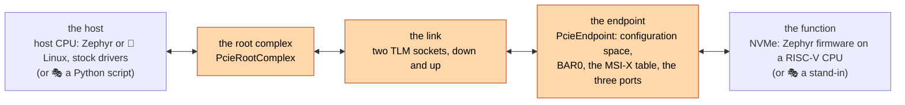
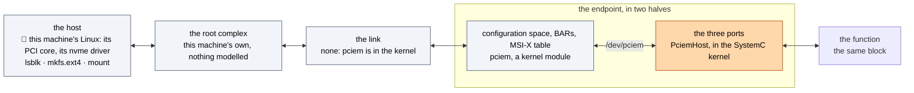
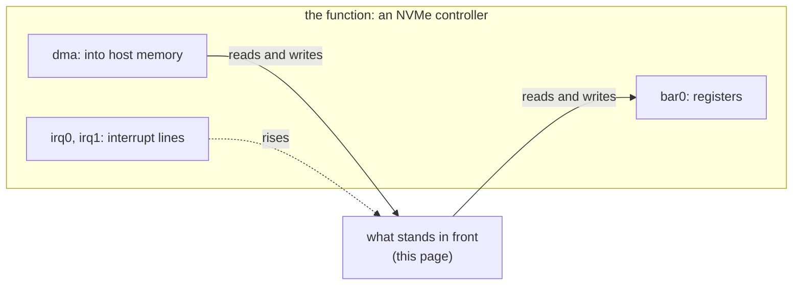
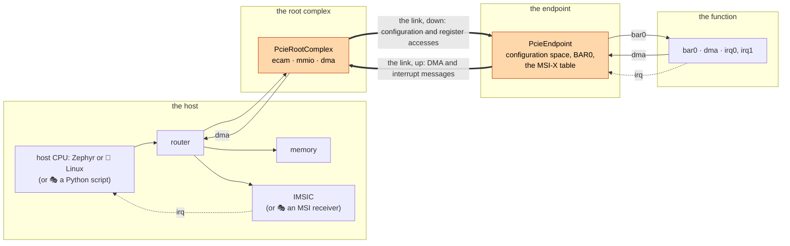
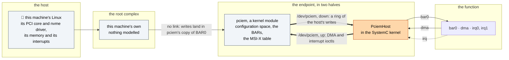
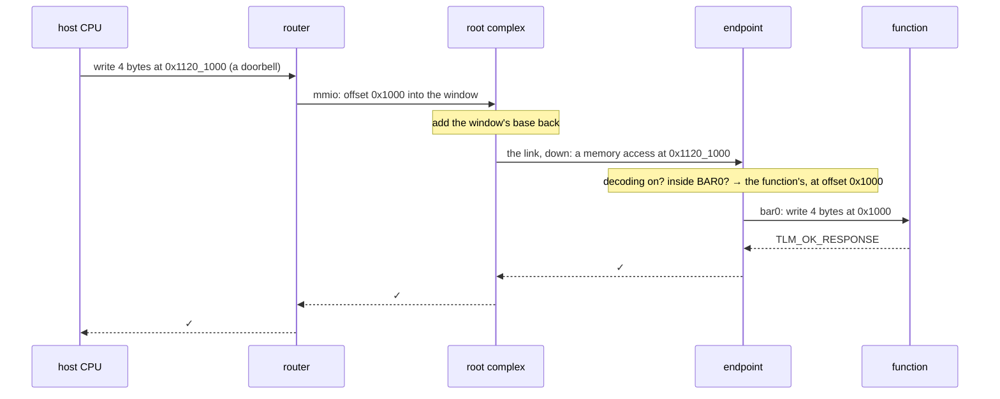
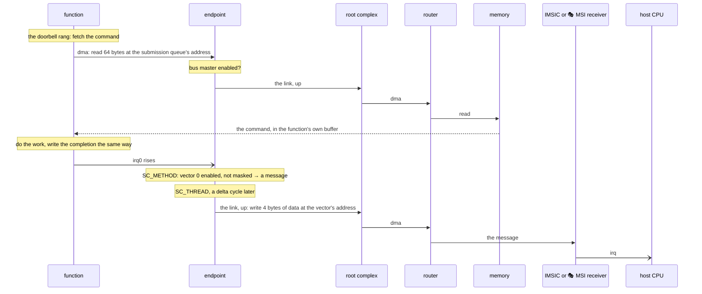
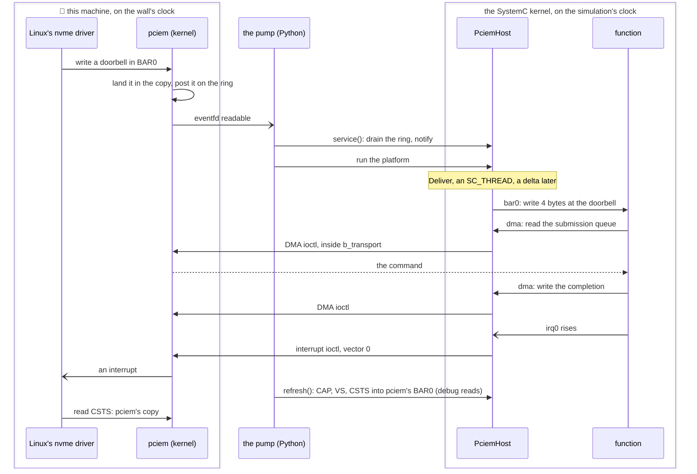

# A PCIe device and its hosts

socpuppet simulates a PCIe device, an NVMe SSD, and gives it a host: a Python script, Zephyr or 🐧 Linux on a simulated CPU beside it, or this machine's own Linux through pciem. This page is first what that lets you do, then how it works down to the SystemC calls, with a command to run at each step. The pages under [`models/`](architecture.md#the-models) take one block each.

## What it can do

- 🎭 **The device is the subject, not the host.** The SSD under test is simulated, with real Zephyr firmware on a RISC-V core or a stand-in (a simplified model), and the host is whatever you swap in; the device cannot tell.
- 🧵 **Three hosts, no driver of ours.** A Python script enumerates, places and drives the drive in under a second on every push, and Zephyr's and Linux's own PCIe and NVMe drivers do the same on a simulated CPU, deterministically.
- 🐧 **This machine mounts it.** Through pciem, a Linux kernel module, the simulated SSD appears on this computer's own PCIe bus: `lsblk` lists it, `mkfs.ext4` and `mount` work, and Python reads the file back out of the simulated NAND.
- 🔧 **Every access visible, every path tested.** Nothing crosses the link unseen, so the tracer shows each register write, DMA and interrupt message; one contract suite holds both NVMe functions to the same behaviour; open tools only, no licence server.

**In the simulation**, every part is a SystemC model on one clock:



**Through pciem**, the same five parts in the same order, but the host and the root complex are this machine's own, there is no link, and the endpoint is in two halves, one in the kernel and one in the simulation:



Both pictures have the same five parts in the same order. The function is the same block in both, and so are its tests; what changes is which of the other four are simulated and who plays them. The rest of this page is that path, from the host's write to the function's register and back.

## To its host, a device is three things

🎓 PCIe (PCI Express) is how a computer talks to the devices plugged into it. A device is not at a fixed address: the host finds it, asks what it is, gives it a place in memory, and only then does a driver talk to it. To that driver a device is three things:

1. **Registers at an address.** The device asks for a piece of the host's address map through a *base address register* (BAR), and the host says where the piece goes.
2. **DMA.** *Direct memory access*: the device reads and writes the host's memory itself. Nobody copies a command to an NVMe drive; the drive fetches it.
3. **Interrupts.** A PCIe device has no interrupt wire. It writes a small message to an address the host chose, and something there turns the write into an interrupt. This is a *message-signalled interrupt*; *MSI-X* is the current form.

Before any of those, 4 KiB of **configuration space** says who made the device (vendor ID), which device it is (device ID) and what kind (class code). The host reads it to find the device and pick a driver, and writes it to place the BAR and switch the device on.

socpuppet draws its line there. The **function** does the device's work, here an NVMe controller, and has exactly three kinds of port: `bar0`, its registers; `dma`, its way into host memory; and `irq0`, `irq1`, ... one line per *vector*, MSI-X's word for one interrupt the host can tell from the others. The function knows nothing of PCIe. This page is about what stands in front of those three ports.



🎓 If you have built a virtual platform of a server, this is the other way round: there the host is the subject and a device is a stub that satisfies the driver. Here the device is the subject, and the host is the part that swaps: a Python script, Zephyr or Linux on the simulated CPU, or this machine's own Linux. The function, and its tests, stay the same.

Two functions play the drive, both with the three ports. 🎭 [The behavioral NVMe](models/behavioral-nvme.md) is a **stand-in**, a simplified model that answers every command itself, with no CPU or firmware. [The SSD](architecture.md#the-ssd) is the real thing in small: the [NVMe frontend](models/nvme-frontend.md) keeps the queues, a 32-bit RISC-V CPU runs Zephyr firmware that decides what each command means, and a [DMA engine](models/dma-engine.md), a [flash controller](models/flash-controller.md) and a NAND move the data. One contract suite, `tests/cpp/contracts/nvme_contract.h`, holds both to what an NVMe function must do.

## Two ways to give it a host

The same five parts as the two pictures at the top, in the same order, with the detail.

**In the simulation**:



**Through pciem**:



**In the simulation**, the host's bus meets a [PCIe root complex](models/pcie-root-complex.md), the host's end of PCIe: two windows in the address map, one for configuration space and one for the device's registers, and a link down. At the other end a [PCIe endpoint](models/pcie-endpoint.md) wraps the function: it is the configuration space, the BAR and the MSI-X table, and it carries the function's DMA and interrupts up the link. Three hosts have stood here, and none changed the device:

| The host | Its firmware | Takes the interrupt messages | Shown in |
|---|---|---|---|
| 🎭 A Python script in the CPU's place | the script: `sp.PcieHost` finds and places the drive, `sp.NvmeHost` drives it | 🎭 [an MSI receiver](models/msi-receiver.md), one register | `examples/nvme_hello.py`, `tests/python/test_nvme_over_pcie.py` |
| The host CPU, Zephyr | Zephyr's own PCIe and NVMe drivers, with socpuppet's root complex driver | the [IMSIC](models/imsic.md), the interrupt controller RISC-V servers use | `examples/host_and_ssd_hello.py`, [boards.md](boards.md#with-a-drive) |
| The host CPU, 🐧 Linux | a stock kernel: `pci-host-ecam-generic` finds the root complex, `nvme` the drive | the IMSIC, by the devicetree's `msi-parent` | `tests/python/test_linux_nvme.py`, [linux.md](linux.md#its-root-on-the-drive) |

**Through pciem**, the host is the Linux you are running on. [pciem](https://github.com/cakehonolulu/pciem) is a kernel module that lets a program be a PCIe device on the machine's own bus: its kernel side plays configuration space, the BARs and the MSI-X table, and hands the program the rest. [`sp.PciemHost`](models/pciem-host.md) is the program's side, inside the SystemC kernel, with the function's three ports on its other face. Root complex, link and host CPU are gone, because this machine's are the real ones; the endpoint is in two halves, its registers in pciem and its three ports in `PciemHost`. The function cannot tell: `PcieEndpoint` and `PciemHost` are both a `PcieFunctionFront` in Python, with the same five parameters, and `connect_the_function` in `python/socpuppet/boards/drive.py` wires either to the function port for port.

| | In the simulation | Through pciem |
|---|---|---|
| The host | a script, or Zephyr or Linux on the simulated CPU, with simulated memory and the IMSIC | this machine's Linux, with nothing played: its PCI core, its nvme driver, its memory and its interrupts |
| The root complex | `PcieRootComplex`, ours | this machine's own, nothing modelled |
| The link | two TLM sockets, down and up | none: pciem is in the kernel, and the host's writes land in its copy of BAR0 |
| The endpoint | `PcieEndpoint`, ours: configuration space, BAR0, the MSI-X table and the three ports | in two halves: pciem's kernel side plays configuration space, the BARs and the MSI-X table, and `PciemHost`, ours, has the three ports, with `/dev/pciem` between them |
| The function | the same block, on its three ports | the same block, on its three ports |
| Time | one simulated clock for host and device | the host on the wall's clock, the device on the simulation's, kept together by the pump |
| Needs | a `dev` build; firmware for the Zephyr and Linux hosts | a build with pciem, on Linux, the module loaded, root for the host's commands |
| Proves | the device against a driver, deterministically, on every push | the device against a real OS's driver: `mkfs`, `mount`, a file written |

## How PCIe lands on SystemC

🎓 In TLM-2.0, the modelling standard that ships with SystemC, blocks hand each other whole *transactions* ("write these 4 bytes at this address") through function calls, out of an *initiator socket* and into a *target socket*. The call is `b_transport`; `transport_dbg`, the *debug transport*, carries the same transaction in no simulated time and unnoticed, as a debugger reads memory. Code that waits runs in a *process* (`SC_THREAD` or `SC_METHOD`), and a *delta cycle* is one round of "run everything that is ready" at one moment of simulated time. [architecture.md](architecture.md#words-you-will-meet) has the longer entries.

PCIe on SystemC comes down to one question, asked at each step: an access has arrived, so whose is it?

### The link: two sockets and a marker

A real link carries packets, and a packet says which of the device's address spaces it is for. That is what a driver can observe, so that is what is kept (`src/socpuppet/models/pcie_link.h`). The link is a pair of ordinary TLM sockets, one per direction, and a transaction on it is one of two things:

- **A memory access**: an ordinary transaction at an address on the host's bus. Down, the host reaching the device's registers; up, the device's DMA or an interrupt message.
- **A configuration access**: the same transaction carrying a TLM *extension*, `PcieConfigurationAccess`, for as long as it is on the link. Its address is an offset into configuration space.

Whatever the device sends up, DMA and interrupt messages alike, carries a second extension, `PcieRequesterId`: the device's *requester ID*, its bus, device and function numbers packed as `bus << 8 | device << 3 | function`, which an [IOMMU](models/iommu.md) looks the device up by. The endpoint learns it as a real function does, from the configuration writes addressed to it: a configuration access says which function it is for, and the root complex takes that from where the access fell in the ECAM window, whose layout is the same packing. No packets, lanes, training or errors.

### The root complex: two windows down, one way up

`PcieRootComplex` (`src/socpuppet/models/pcie_root_complex.h`) has two target sockets the host's bus maps as windows:

- **`ecam`**, the configuration window. 🎓 ECAM, the enhanced configuration access mechanism, gives every function a bus could hold 4 KiB, laid out by bus, device and function number. The root complex divides the address by 4 KiB: function 0 gets its access, marked as configuration with the remainder as the offset; any other slot reads all ones with no error, which is how a host learns what it has.
- **`mmio`**, the memory window. A bus hands a target offsets into its window, and the device compares host-bus addresses, so the root complex adds the window's base back. 💡 It learns that base from where `mmio` is mapped when the platform is built.
- **`from_device`**, the link up, goes out of **`dma`** onto the host's bus untouched: DMA and interrupt messages are just accesses at host addresses.

### The endpoint: whose address is this?

`PcieEndpoint` (`src/socpuppet/models/pcie_endpoint.h`) is a thin SystemC wrapper around `PcieEndpointRegisters` (`src/socpuppet/core/pcie_endpoint_registers.h`), plain C++ with no simulator: the configuration registers, one 64-bit BAR, the capability list, the MSI-X table, and every decision that hangs on them. A configuration access reads or writes those registers; a write may move BAR0 or switch on *memory decoding* and *bus mastering* in the command register. A memory access is decoded against BAR0:

| It lands | The endpoint |
|---|---|
| nowhere: decoding off, or outside BAR0 | answers `TLM_ADDRESS_ERROR_RESPONSE` (⚠️ a real bus answers a stray read with all ones) |
| in the function's registers, the first `function_size` bytes | rewrites the address as an offset and forwards out of `bar0` |
| in the MSI-X table, the page after | reads or writes the table: each vector's address, data and mask |
| in the pending bits, the page after that | reads them |

The function sees a plain write at an offset into its registers, as if it were mapped straight onto a bus, which is how its own tests drive it.



### DMA: straight through, once allowed

The function's `dma` socket is bound to the endpoint's. The endpoint checks one bit, *bus master enable*, and either forwards the transaction up the link as it is or refuses it with `TLM_GENERIC_ERROR_RESPONSE`. 🎓 A PCIe device may touch nothing in its host's memory until the host has made it a bus master; a driver that forgets the bit sees a drive that never fetches its first command ([lessons.md](history/lessons.md#pcie-and-nvme)). The root complex puts the access on the host's bus and the router finds the memory. No bytes are copied: the transaction's data pointer is the function's buffer end to end.

### Interrupts: a wire in, a write out

Each interrupt line is a SystemC signal, and an `SC_METHOD` in the endpoint is sensitive to every rising edge. A rise asks the MSI-X table about that vector. Enabled and unmasked, the answer is a *message*: the address and 32 bits of data the host wrote into the table. Masked, it is remembered as pending and sent when the host unmasks it. The message is a 32-bit little-endian write up the link, made by an `SC_THREAD` of the endpoint's own, a delta cycle after the rise.

💡 Why a thread, and why a delta later? A bus access may have to wait, and only a thread can; and the write must not start inside somebody else's access, such as the host's configuration write that unmasked the vector. If nothing answers the message, the endpoint sets the *received master abort* bit, the one place a driver can see that its interrupts go nowhere.

What answers is the host's business: 🎭 the scripted host's MSI receiver, one register whose line is high until read, or the firmware hosts' IMSIC, the real controller for incoming messages, which Zephyr's and Linux's drivers both point the table at.



### Debug accesses, DMI and time

Every socket on the path answers `transport_dbg` as it answers `b_transport`, so `platform.peek` and GDB see configuration space through the ECAM window and the registers through the memory window, with no time passing and no side effects. DMI, the raw pointer that lets a CPU skip the bus, does not cross the link: every access to the device goes through the sockets, where the [tracer](models/tracer.md) sees it. Nothing on the path takes time, by the rule that what a block does matters and how long it takes is a tier ([vision.md](vision.md#how-choices-get-made)): a message leaves a delta cycle after its line rises, at the same simulated time.

## How pciem lands on SystemC

Now the host is outside the simulation on the wall's clock, and the function inside on the simulation's. `PciemHost` (`src/socpuppet/models/pciem_host.h`) and the pump (`python/socpuppet/pump.py`) bridge the two.

pciem gives the program three things, which match the function's three ports but not one for one:

- **BAR0 as shared memory, and a ring of the host's writes to it.** When Linux's driver writes a register, pciem lands the write in its copy of BAR0, posts it on a ring with its offset, size and data, and an eventfd becomes readable. ⚠️ The host's *reads* never reach the program: Linux reads pciem's copy. So a register the function changes on its own must be copied in before the host looks. For NVMe those are CAP, VS and CSTS.
- **An ioctl for DMA**, a copy to or from this machine's memory.
- **An ioctl for an interrupt**, which sends the host one vector.

Everything from the host arrives outside the simulation, and everything that touches the function must happen inside a SystemC process, so each direction has a hand-over:

- **Writes, in.** The pump sees the eventfd readable and calls `service()`, which drains the ring into a queue and notifies a SystemC event. `Deliver`, an `SC_THREAD`, wakes a delta later and makes each write on `bar0` in order. A write the function refuses is counted; the host never hears of it, as on a real bus.
- **DMA, out.** The function's `dma` transaction arrives in the function's own process, and `PciemHost` makes the ioctl right there, inside `b_transport`. An address pciem refuses is a `TLM_GENERIC_ERROR_RESPONSE`.
- **Interrupts, out.** An `SC_METHOD` on each rising edge makes the interrupt ioctl. 🎓 The lines are *levels* and the host is sent *edges*: after a completion queue's head doorbell, NVMe asks for a new message if completions are still waiting, so `Deliver` waits one delta and sends again each vector whose line is still high.
- **Registers, out.** At every look, `refresh()` copies CAP, VS and CSTS into pciem's BAR0 with debug reads.



**The pump** keeps the two clocks together. While the SSD's CPU has work, the simulation runs flat out and looks at the eventfd every 10 ms. When the CPU sleeps, the pump waits on the wall with `select` on the eventfd, for the length of the sleep or one second, then moves the simulated clock on by the wall time that passed. 🎓 QEMU's `-icount sleep=on` is the same idea. ⚠️ Linux's timeouts are on the wall, 30 s per I/O command, and an unpumped drive is a drive that does not answer: from `start()` until Linux's driver lets go, the platform has to be pumped, which is why the drive is unbound before the program ends.

pciem gives the device one legacy interrupt, since its virtual root has no MSI domain, so Linux makes one I/O queue; and there is no link for the tracer to show. The rest is on [the component's page](models/pciem-host.md#what-it-leaves-out) and in [upstream.md](upstream.md#pciem).

## Where Python holds the strings

🧵 Python describes the platform, can play the host, and runs and watches the show.

### Describing

`add` puts a component in a platform, `connect` binds port to port, `map` puts a target socket at an address on a bus. The drive on its link (`python/socpuppet/boards/drive.py`):

```python
nvme = ssd.add("nvme", sp.BehavioralNvme(blocks=2048, vectors=2))
endpoint = ssd.add("endpoint", sp.PcieEndpoint(
    vendor_id=0x5350, device_id=0xC0DE, class_code=0x01_08_02,   # mass storage, NVMe
    function_size=sp.BehavioralNvme.mapped_size, vectors=2))
platform.connect(rc.to_device, endpoint.from_host)   # the link, down
platform.connect(endpoint.to_host, rc.from_device)   # the link, up
platform.connect(endpoint.bar0, nvme.bar0)           # the function's three ports
platform.connect(nvme.dma, endpoint.dma)
platform.connect(nvme.irq0, endpoint.irq0)
platform.connect(nvme.irq1, endpoint.irq1)
```

The root complex's windows go on the host's bus with `bus.map(rc.ecam, ...)` and `bus.map(rc.mmio, ...)`, and the link up with `platform.connect(rc.dma, bus.add_input())`. For the real host, `ssd(host=this_machine)` puts `sp.PciemHost` where the endpoint and the scripted host go, and `connect_the_function` makes the same three connections. `platform.build()` elaborates it all into one SystemC kernel. ⚠️ Once per process: the kernel cannot be restarted, and after a run it is not resting, it is an ex-kernel.

### Playing the host

A host with no CPU is a Python generator on 🎭 [`sp.ScriptedBusMaster`](models/scripted-bus-master.md): each `yield` is one bus operation. The steps a host takes on a PCIe bus are generators too ([`sp.PcieHost`](models/pcie-host.md), from `examples/nvme_hello.py`):

```python
def script():
    pci = sp.PcieHost(ecam=IO_BASE + ECAM_OFFSET)
    (drive,) = yield from pci.scan()                  # 1. enumerate: read every slot's first register
    msi = sp.MsiHost(receiver=MSI_BASE)
    yield from pci.place(drive, registers)            # 2. write BAR0, switch on decoding and bus mastering
    yield from pci.route_interrupts(drive, to=msi)    # 3. fill the MSI-X table, enable MSI-X
    nvme = sp.NvmeHost(registers=registers, memory=RAM_BASE, interrupt=msi.wait)
    yield from nvme.enable()                          # 4. only now is there a drive to drive
    yield from nvme.write_blocks(first=7, data=block)
```

💡 Each step is bus operations and nothing else, so `tests/python/test_pcie.py` runs them against a dictionary standing in for configuration space, with no simulator, to test the rarer paths. The firmware hosts need none of this: Zephyr's and Linux's own PCIe code does steps 1 to 3, and the drive sees the same writes.

### Running, pumping and watching

`platform.run()` runs until nothing is left to do, which ends the scripted show. With a real host there is always more, so [`socpuppet.pump.pump`](models/pciem-host.md#what-it-does) runs it with the host as a *far end*: anything with a file descriptor to wait on, `service()` and `refresh()` to call, and `due_in()` to say when it has a timer of its own to keep.

```python
from socpuppet.boards.real_host import this_machine
from socpuppet.boards.ssd import ssd
from socpuppet.pump import pump

board = ssd(host=this_machine, blocks=131072)      # 64 MiB
board.platform.build()
board.platform.load_elf("build/firmware/ssd_socpuppet_ssd.elf", via=board.ssd.cpu.socket)
board.host.start()                                 # on the bus: Linux binds it at once
pump(board.platform, far_ends=[board.host], until=lambda: done)
```

To watch, mark a connection `trace=True` and read `platform.trace`: `examples/nvme_hello.py` traces the link up onto the host's bus and counts the drive's DMA and interrupt messages. `platform.peek(address, length)` reads anything on the path with a debug access, configuration space included.

| 🧵 Python | C++ | Registry name | Page |
|---|---|---|---|
| `sp.PcieRootComplex()` | `socpuppet::PcieRootComplex` | `pcie_root_complex` | [pcie-root-complex.md](models/pcie-root-complex.md) |
| `sp.PcieEndpoint(...)` | `socpuppet::PcieEndpoint`, `PcieEndpointRegisters`, `MsixTable` | `pcie_endpoint` | [pcie-endpoint.md](models/pcie-endpoint.md) |
| `sp.PciemHost(...)` | `socpuppet::PciemHost`, `PciemDevice` | `pciem_host` | [pciem-host.md](models/pciem-host.md) |
| 🎭 `sp.BehavioralNvme(blocks=...)` | `socpuppet::BehavioralNvme`, `NvmeController` | `behavioral_nvme` | [behavioral-nvme.md](models/behavioral-nvme.md) |
| `sp.NvmeFrontend()` | `socpuppet::NvmeFrontend` | `nvme_frontend` | [nvme-frontend.md](models/nvme-frontend.md) |
| 🎭 `sp.MsiReceiver()` | `socpuppet::MsiReceiver` | `msi_receiver` | [msi-receiver.md](models/msi-receiver.md) |
| 🎭 `sp.PcieHost`, `sp.MsiHost`, `sp.NvmeHost` | none: Python generators | | [pcie-host.md](models/pcie-host.md), [nvme-host.md](models/nvme-host.md) |
| `socpuppet.pump.pump` | none: Python, calling `step` and `run` | | [pciem-host.md](models/pciem-host.md) |

## Try it

Cheapest first, from the checkout after [setup.md](setup.md)'s build. Times are from one laptop.

| Show | The host | Needs | Takes |
|---|---|---|---|
| 1. A script finds the drive, no CPUs | 🎭 Python | a `dev` build | under a second |
| 2. Zephyr finds it, and the SSD answers with its own firmware | Zephyr on the host CPU | `uv run firmware/build.py` | under a second |
| 3. Linux finds it | 🐧 Linux on the host CPU | the firmware above, with Linux | about four minutes |
| 4. This machine mounts it | 🐧 this machine's Linux | pciem built and loaded, root for the host's commands | seconds |

**1. A script finds the drive.** The host is a script, the drive is 🎭 the behavioral NVMe, and between them the root complex, the link and the endpoint of this page:

```sh
PYTHONPATH=python uv run python examples/nvme_hello.py
```

```text
Found a device at 00:00.0: vendor 0x5350, device 0xc0de, class 0x010802, which is an NVMe drive.
It holds 2048 blocks of 512 bytes: 1.0 MB.
21 accesses came up the link from the drive, 6 of them interrupt messages.

✅ Wrote a block and read it back: "Hello from the host, by way of PCIe."
```

The 21 accesses are the drive fetching commands, moving blocks, posting completions and sending six messages. The tests that hold this path run on every push:

```sh
uv run pytest tests/python/test_nvme_over_pcie.py tests/python/test_pcie.py      # 32 passed in 2.4 s
uv run ctest --preset dev -R 'Endpoint|Msix|Capability|Pciem'           # the C++ side: tests/cpp/platform/pcie_test.cpp and more
```

**2. Zephyr finds it.** The host CPU runs Zephyr's own disk test, built with the shield `socpuppet_host_drive`, and the drive is the SSD with its 32-bit CPU running the Zephyr application in `firmware/ssd`. Zephyr's PCIe code scans, places and routes; its NVMe driver reads and writes; neither image was built for the other.

```sh
uv run firmware/build.py                                   # once: every image the tests boot, into build/firmware
PYTHONPATH=python uv run python examples/host_and_ssd_hello.py
```

```text
...
571.4  host  TESTSUITE disk_driver succeeded
573.1  host  SUITE PASS - 100.00% [disk_driver]: pass = 2, fail = 0, skip = 1, total = 3 duration = 0.432 seconds

✅ Two firmwares, one clock: the host's disk test passed against the SSD's firmware in 576.5 ms of simulated time.
```

The two consoles print as one story, in simulated milliseconds. Leave `drive=` off `host()` and the same image passes against 🎭 the stand-in drive ([boards.md](boards.md#with-a-drive)).

**3. Linux finds it.** A stock kernel on OpenSBI: `pci-host-ecam-generic` reads the root complex's devicetree node, enumerates, places the BAR and routes MSI-X to the IMSIC, and `nvme` loads from the initramfs and finds the drive. Nothing of socpuppet's runs on the host.

```sh
uv run pytest tests/python/test_linux_nvme.py -rs                  # the stand-in drive, three tests, about four minutes
PYTHONPATH=python uv run python -m socpuppet linux --root drive    # the SSD as Linux's root filesystem, a shell at the end
```

Both need Linux's images in `build/firmware`. A boot takes minutes on the interpreter, so these tests are `long` and run nightly ([linux.md](linux.md) has how to read a boot that stops).

**4. This machine mounts it.** 🐧 Linux only, after [setup.md's pciem section](setup.md#6-pciem-optional): the module built and loaded (root and a reboot, once) and a build of socpuppet with it. `uv run python tools/doctor.py pciem` says what is missing. Then put the drive on the bus and look from another terminal:

```sh
PYTHONPATH=python uv run python -m socpuppet drive              # the SSD with its Zephyr firmware, 64 MiB, until Ctrl-C
PYTHONPATH=python uv run python -m socpuppet drive --firmware behavioral --blocks 2048
```

```sh
lsblk                                                           # a new 64M disk, no partitions yet
```

The program says where on the bus the drive is. Ctrl-C ends it; if Linux's driver still holds the drive it prints the `unbind` line to type as root and waits, because a drive that vanishes with commands outstanding costs the driver half a minute each. Linux cannot tell the puppet from a card in a slot, and neither can `lsblk`, which is the point, and also why the drive is found by its place on pciem's bus (`socpuppet.boards.real_host.puppet_function()`) and never by name: formatting the wrong disk is a sketch nobody wants to be in. `tests/python/test_this_machines_linux_mounts_the_ssd.py` goes on to `mkfs.ext4`, `mount`, a file written, `umount`, and Python reading the file back out of the simulated NAND.

Without a prepared machine: `tests/python/test_real_host_board.py` checks the wiring with `PciemHost` in it without building a platform, so it runs anywhere; and the nightly job runs the real thing in a QEMU guest of this machine's own, with no reboot ([development.md](development.md#pciem-a-real-host)):

```sh
uv run tools/pciem_guest.py -- env SOCPUPPET_REQUIRE_PCIEM=1 .venv/bin/python -m pytest tests/python/test_pciem_contract.py
```

## What it leaves out

- **The link itself**: no packets, lanes, training, flow control or errors ([pcie-root-complex.md](models/pcie-root-complex.md#what-it-leaves-out)).
- **A tree**: one device, function 0 of device 0 on bus 0; no bridges or switches.
- **More than one BAR**, I/O ports, an expansion ROM, or a capability other than MSI-X ([pcie-endpoint.md](models/pcie-endpoint.md#what-it-leaves-out)).
- **Interrupts other than MSI-X**: no interrupt pin, no plain MSI.
- **Confinement, unless asked**: every access up the link says which device sent it, and nothing checks it but an [IOMMU](models/iommu.md) in the way, which the host has with `host(iommu=True)`.
- **DMI across the link**, by design, so every access to the device is visible.
- **Under pciem**: one interrupt and so one I/O queue, no endpoint of ours, two clocks held together by the pump, and a GPL-2.0-only header that keeps it out of the wheel ([pciem-host.md](models/pciem-host.md#what-it-leaves-out), [upstream.md](upstream.md#pciem)).
- ⚠️ All of it is modelled from public sources, Zephyr's PCIe headers and SPDK's NVMe header among them, because the specifications are not free to read, and claims no conformance.

## Where to read next

- The blocks, one page each: [root complex](models/pcie-root-complex.md), [endpoint](models/pcie-endpoint.md), [this machine as the host](models/pciem-host.md), 🎭 [the scripted host's PCIe steps](models/pcie-host.md), 🎭 [the behavioral NVMe](models/behavioral-nvme.md), [the NVMe frontend](models/nvme-frontend.md), 🎭 [the MSI receiver](models/msi-receiver.md), [the IMSIC](models/imsic.md).
- Why the endpoint is socpuppet's own and not VCML's: [history/pcie-spike.md](history/pcie-spike.md).
- How a real host first mounted the puppet's SSD, with timings: [history/real-host-spike.md](history/real-host-spike.md).
- Lessons in [lessons.md](history/lessons.md#pcie-and-nvme); what is owed upstream in [upstream.md](upstream.md#pciem); where the drive sits on each board in [address-map.md](address-map.md).
