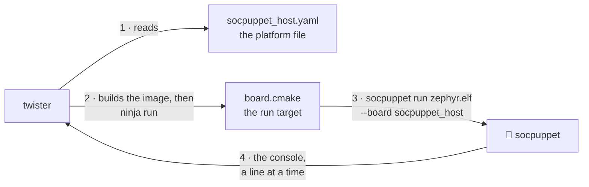

# Run Zephyr's tests on the puppet 🧦

Zephyr comes with thousands of tests of itself: of its scheduler, its timers, its C library, its drivers. Most of them need nothing but a CPU, a timer, an interrupt controller and a console, and a socpuppet board has all four. So Zephyr's own tests are also tests of socpuppet's models, written by people who never heard of it, and this page is how to run them.

🎓 Two names first. **ztest** is Zephyr's test framework: the thing a test is written in, which prints `PASS - test_spam in 0.003 seconds` for each case and `PROJECT EXECUTION SUCCESSFUL` when all of them are over. **Twister** is Zephyr's test runner: it finds test suites in a directory, builds each one for each board it is asked about, runs the image on an emulator or on real hardware, and reads the console for a verdict. Zephyr's own CI is twister on a thousand boards. Here it is twister on three.

## One command

```sh
firmware/build.sh             # once: fetches Zephyr and its SDK, builds the boot ROMs
firmware/twister.sh --suites  # every suite of the list, on every board
```

The first prints nothing of interest. The second ends like this, once for each run of twister it makes:

```text
INFO    - 87 of 99 executed test configurations passed (87.88%), 0 built (not run), 0 failed, 0 errored, with no warnings in 385.15 seconds.
INFO    - 2063 of 2063 executed test cases passed (100.00%) on 3 out of total 1476 platforms (0.20%).
Verdicts and logs: build/twister/out
```

💡 Read the second number of the first line with the third and fourth. The twelve configurations that did not pass did not fail either: they are the ones [left out on purpose](#what-is-left-out-and-why), which twister counts among the executed.

It needs a socpuppet built for the machine it runs on (`uv run cmake --build --preset dev`, see [development.md](development.md)). On an Intel Mac it runs itself in Docker, as `firmware/build.sh` does, because the Zephyr SDK has no compiler for one. ⚠️ The first run there builds socpuppet for Linux, which takes about ten minutes, and copies Zephyr and its SDK to a Docker volume called `socpuppet-twister`. After that the whole list takes about eight minutes on the sixteen-core machine it was measured on.

To run less, give twister's own options after the script's name, or after `--suites`:

```sh
firmware/twister.sh --suites -p socpuppet_host                 # the list, on one board
firmware/twister.sh -p socpuppet_ssd -T tests/kernel/sleep -v  # one suite of Zephyr's
firmware/twister.sh -p socpuppet_ssd -T firmware/flash_test    # one of ours
```

`-T` names a directory to look for suites in. A relative one is in Zephyr's tree, or in this repository if it starts with `firmware/` or `python/`. `-p` names a board, and `-v` prints each scenario's verdict as it comes.

What is left behind, in `build/twister/out/<run>/`. A run is one run of twister: `--suites` makes one called `suites` for most of the list and one for each suite that needs flags of its own, named after the suite, and a command without `--suites` makes one called `one`.

| File | What |
|---|---|
| `twister.json` | Every scenario on every board: its verdict, its cases, how long it took, and why it was skipped if it was |
| `twister.xml`, `twister_report.xml` | The same as JUnit XML, which a CI knows how to show |
| `twister.log` | Twister's own account of the run: what it left out and why |
| `<board>/…/<scenario>/handler.log` | The console of that run. The first place to look when a scenario fails |
| `<board>/…/<scenario>/handler_stderr.log` | What `socpuppet run` said of how the run ended, when it ended with no verdict |
| `<board>/…/<scenario>/build.log` | What CMake and the compiler said |

💡 Twister is for the whole list. When one test fails and you are working on it, build its image once and run it with `socpuppet run`, which takes a second or two and prints the same console:

```sh
socpuppet run build/firmware/flash_test_socpuppet_ssd.elf --board socpuppet_ssd
```

## How twister comes to run socpuppet

Twister knows QEMU and a handful of other emulators by name. For any other it has a mode called `custom`, and three small files are all it takes to use it.



1. **The platform file**, `<board>.yaml` beside the board's `board.yml`, tells twister what the board is: a RISC-V board with so much memory, simulated by an emulator of the `custom` kind whose program is called `socpuppet`. ⚠️ Twister does not run that program. It looks for it on its `PATH`, and a board whose program it cannot find is built and never run, without a word.
2. **`board.cmake`** says what the `run` target of an image's build does. For every socpuppet board that is `socpuppet run <the image> --board <the board>`, with a `--shield` for each shield the image was built with.
3. **`socpuppet run`** describes the board, puts the image where the board's boot ROM will find it, and runs the simulation, printing each line of the console as it becomes whole.
4. **Twister reads those lines.** For a ztest suite it waits for the verdict. For a sample it looks for the lines the sample's own `sample.yaml` says should appear. Then it ends the run.

`firmware/twister.sh` is the rest: it puts a `socpuppet` on the `PATH`, points `ZEPHYR_EXTRA_MODULES` at socpuppet's Zephyr module, where the boards are, and says where the boot ROMs were built (`SOCPUPPET_FIRMWARE_DIR`). With an installed socpuppet and a Zephyr workspace of your own, those three are all you need, and twister is run as for any other board. 🚧 The boot ROMs are not in the package yet, so the second line names where `firmware/build.sh` built them in a checkout:

```sh
export ZEPHYR_EXTRA_MODULES=$(socpuppet zephyr-module)
export SOCPUPPET_FIRMWARE_DIR=/where/the/boot/roms/are
west twister -p socpuppet_host -T tests/kernel/sleep
```

🎓 **Why the boot ROM?** `socpuppet run` could put the image straight into RAM, and `--boot ram` does. But a test of a watchdog lets the watchdog reset its CPU and carries on afterwards, and after a reset only a ROM puts the image's data back as it was. So a run under twister boots as silicon does.

## What is run, and what passes

`firmware/twister-suites.txt` is the list. On 2026-10-11, with Zephyr 4.4.2, in scenarios passed of scenarios run (a suite has a scenario for each configuration it is built in, and twister runs some scenarios on one board of each architecture only):

| Suite | `socpuppet_host` | `socpuppet_ssd` | `socpuppet_iomgr` |
|---|---|---|---|
| `tests/kernel/common` | ✅ 2/2 | ✅ 2/2 | ✅ 9/9 |
| `tests/kernel/threads/thread_apis` | ✅ 1/1 | ✅ 1/1 | ✅ 1/1 |
| `tests/kernel/sched/schedule_api` | ✅ 7/7 | ✅ 7/7 | ✅ 7/7 |
| `tests/kernel/timer/timer_api` | ✅ 1/1 | ✅ 1/1 | ✅ 1/1 |
| `tests/kernel/sleep` | ✅ 2/2 | ✅ 2/2 | ✅ 2/2 |
| `tests/kernel/context` | ✅ 2/2 | ✅ 2/2 | ✅ 2/2 |
| `tests/kernel/workq/work` | ✅ 1/1 | ✅ 1/1 | ✅ 1/1 |
| `tests/kernel/fatal/exception` | ✅ 1/1 | ✅ 1/1 | ✅ 1/1 |
| `tests/arch/riscv/fatal` | ✅ 4/4 | left out | left out |
| `tests/drivers/watchdog/wdt_basic_api` | left out | left out | left out |
| `tests/subsys/shell/shell` | ✅ 2/2 | ✅ 2/2 | ✅ 2/2 |
| `tests/lib/c_lib` | ✅ 7/7 | ✅ 7/7 | ✅ 9/9 |
| `samples/hello_world` | ✅ 1/1 | ✅ 1/1 | ✅ 1/1 |
| `samples/synchronization` | ✅ 1/1 | ✅ 1/1 | ✅ 1/1 |
| **Scenarios** | **32** | **28** | **37** |

97 scenarios and 2073 test cases, and none fails. It was not always so. The first time these suites ran, in the spike that began this ([twister-spike.md](twister-spike.md)), 46 scenarios of 126 did not pass, and they found two bugs in socpuppet that none of its own tests had: firmware could clear an interrupt's pending bit that a real CPU keeps read-only, and the timer charged a CPU for time it had already spent. Both are mended, and both were in borrowed models ([upstream.md](upstream.md)).

## What is left out, and why

`firmware/twister-quarantine.yaml` is twister's own kind of list for this: scenarios it is to skip, each with a comment that it copies into its reports. A suite is never left out by taking it off the list of suites, because then nothing would say that it had been. There are three entries.

- **`drivers.watchdog`, on every board: Zephyr's test and Zephyr's driver disagree.** The test resets the CPU with the watchdog three times, and each time the CPU comes back from its ROM and the test carries on, which is the part that is socpuppet's. Its third case then sets up a timeout that resets the SoC *and* calls a function first, and expects the function to have run. The SiFive watchdog, which is the one socpuppet models, cannot do both, and Zephyr's driver for it says so in a comment, sets up the reset alone and reports success. The test provides for a driver that refuses (`-ENOTSUP`), and this one does not refuse. A real SiFive board would fail the same way. 📮 It is an entry in [upstream.md](upstream.md).
- **`arch.riscv64.fatal.*`, on the two 32-bit boards: it is a test for a 64-bit CPU.** It makes the kernel panic and matches the dump of registers digit for digit, sixteen digits to a register. A 32-bit CPU prints eight. On `socpuppet_host` all four scenarios pass.
- **`libraries.libc.common.stdio.*`, on every board: they want a module socpuppet does not fetch.** These test `stdio` on a file system and include `ff.h` from FatFs, one of Zephyr's external modules. `firmware/build.sh` fetches Zephyr alone, because nothing socpuppet builds needs a module, so they do not build. The rest of the C library's suite runs.

🚧 Not in the list at all yet, because the CPU cannot run them: Zephyr's tests of user mode and memory protection (`tests/kernel/mem_protect`, `tests/arch/riscv/userspace`). They want a core with user mode behind a PMP, which is a to-do in [plan.md](plan.md).

## When a scenario fails

Each failure is one of three things, and the list above has grown out of sorting them:

| What it is | What happens to it |
|---|---|
| A bug in a model, or in socpuppet | It is fixed, test-first, where the cause is. The scenario stays in the list, failing, until it is |
| Something socpuppet does not model | A to-do in [plan.md](plan.md). The scenario is quarantined with that as its reason |
| An assumption of the test's, or a bug of Zephyr's | Quarantined with its reason, and an entry in [upstream.md](upstream.md) if it is Zephyr's to mend |

Start with the scenario's `handler.log`. ⚠️ A run that stops with no verdict and the simulation out of things to do means a CPU asleep with nothing on its way to wake it, and `socpuppet run` says so, in `handler_stderr.log` beside the console.

## In CI

The `twister` job of `.github/workflows/ci.yml` does the same for every pull request and every push to `main`: it restores Zephyr, the SDK and their venv from a cache (or fetches them with `firmware/build.sh`), takes the boot ROMs from the `firmware` job, builds socpuppet as the `test` job does, and runs `firmware/twister.sh --suites`. A scenario that fails fails the job, and the verdicts and every console are kept as the artifact `twister`.

It also runs the tests that need Zephyr's tree and so are skipped everywhere else: the ones that hold the boards' platform files, the list of suites and the quarantine list to twister's own schemas.
