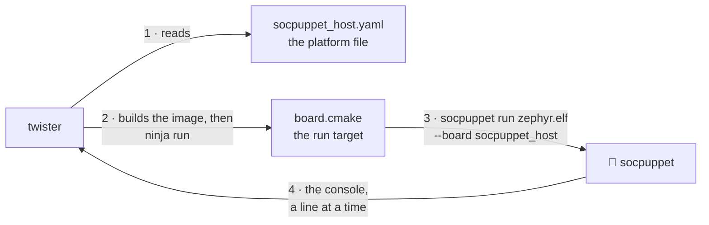

# Run Zephyr's tests on the puppet 🧦

Zephyr comes with thousands of tests of itself: of its scheduler, its timers, its C library, its drivers. Most of them need nothing but a CPU, a timer, an interrupt controller and a console, and a socpuppet board has all four. So Zephyr's own tests are also tests of socpuppet's models, written by people who never heard of it, and this page is how to run them.

🎓 Two names first. **ztest** is Zephyr's test framework: the thing a test is written in, which prints `PASS - test_spam in 0.003 seconds` for each case and `PROJECT EXECUTION SUCCESSFUL` when all of them are over. **Twister** is Zephyr's test runner: it finds test suites in a directory, builds each one for each board it is asked about, runs the image on an emulator or on real hardware, and reads the console for a verdict. Zephyr's own CI is twister on a thousand boards. Here it is twister on three.

## One command

```sh
uv run firmware/build.py rom zephyr-tree   # once: fetches Zephyr and its SDK, builds the boot ROMs
uv run firmware/twister.py --suites               # every suite of the list, on every board
```

The first prints nothing of interest. The second ends like this, once for each run of twister it makes:

```text
INFO    - 103 of 115 executed test configurations passed (89.57%), 0 built (not run), 0 failed, 0 errored, with no warnings in 383.99 seconds.
INFO    - 2143 of 2143 executed test cases passed (100.00%) on 3 out of total 1476 platforms (0.20%).
Verdicts and logs: build/twister/out
```

💡 Read the second number of the first line with the third and fourth. The twelve configurations that did not pass did not fail either: they are the ones [left out on purpose](#what-is-left-out-and-why), which twister counts among the executed.

It needs a socpuppet built for the machine it runs on (`uv run cmake --build --preset dev`, see [development.md](development.md)). On an Apple silicon Mac that is all it needs: the Zephyr SDK has a compiler for one, `firmware/build.py` fetches it, and twister runs on macOS itself, with no Docker. The whole list takes six and a half minutes there, on a ten-core M4. On an Intel Mac it runs itself in Docker, as `firmware/build.py` does, because the Zephyr SDK has no compiler for one. ⚠️ The first run there builds socpuppet for Linux, which takes about ten minutes, and copies Zephyr's tree to a Docker volume called `socpuppet-twister-ubuntu-26.04`, after the image's Ubuntu; the SDK and the venv are Linux's own, which are on a volume already. A volume an older run filled holds a copy of the SDK, a venv and a Python too, which `docker volume rm socpuppet-twister-ubuntu-26.04` throws away, to be filled afresh. After that the whole list takes seven and a half minutes on the sixteen-core machine it was measured on. [In CI](#in-ci) has the four places side by side.

To run less, give twister's own options after the script's name, or after `--suites`:

```sh
uv run firmware/twister.py --suites -p socpuppet_host                 # the list, on one board
uv run firmware/twister.py -p socpuppet_ssd -T tests/kernel/sleep -v  # one suite of Zephyr's
uv run firmware/twister.py -p socpuppet_ssd -T firmware/flash_test    # one of ours
```

`-T` names a directory to look for suites in. A relative one is in Zephyr's tree, unless it is `firmware` or `python`, or under one of them: those are this repository's. `-p` names a board, and `-v` prints each scenario's verdict as it comes.

What is left behind, in `build/twister/out/<run>/`. A run is one run of twister: `--suites` makes one called `suites` for most of the list and one for each suite that needs flags of its own, named after the suite, and a command without `--suites` makes one called `one`.

| File | What |
|---|---|
| `twister.json` | Every scenario on every board: its verdict, its cases, how long it took, and why it was skipped if it was |
| `twister.xml`, `twister_report.xml` | The same as JUnit XML, which a CI knows how to show |
| `twister.log` | Twister's own account of the run: what it left out and why |
| `<board>/…/<scenario>/handler.log` | The console of that run. The first place to look when a scenario fails |
| `<board>/…/<scenario>/handler_stderr.log` | What `socpuppet run` said of how the run ended, when it ended with no verdict |
| `<board>/…/<scenario>/build.log` | What CMake and the compiler said |

💡 Twister is for the whole list. When one test fails and you are working on it, build its image once and run it with `socpuppet run`, which takes a second or two and prints the same console:

```sh
socpuppet run build/firmware/flash_test_socpuppet_ssd.elf --board socpuppet_ssd
```

## How twister comes to run socpuppet

Twister knows QEMU and a handful of other emulators by name. For any other it has a mode called `custom`, and three small files are all it takes to use it.



1. **The platform file**, `<board>.yaml` beside the board's `board.yml`, tells twister what the board is: a RISC-V board with so much memory, simulated by an emulator of the `custom` kind whose program is called `socpuppet`. ⚠️ Twister does not run that program. It looks for it on its `PATH`, and a board whose program it cannot find is built and never run, without a word.
2. **`board.cmake`** says what the `run` target of an image's build does. For every socpuppet board that is `socpuppet run <the image> --board <the board>`, with a `--shield` for each shield the image was built with.
3. **`socpuppet run`** describes the board, puts the image where the board's boot ROM will find it, and runs the simulation, printing each line of the console as it becomes whole.
4. **Twister reads those lines.** For a ztest suite it waits for the verdict. For a sample it looks for the lines the sample's own `sample.yaml` says should appear. Then it ends the run.

`firmware/twister.py` is the rest: it puts a `socpuppet` on the `PATH`, points `ZEPHYR_EXTRA_MODULES` at socpuppet's Zephyr module, where the boards are, and says where the boot ROMs were built (`SOCPUPPET_FIRMWARE_DIR`). With an installed socpuppet and a Zephyr workspace of your own, those three are all you need, and twister is run as for any other board. 🚧 The boot ROMs are not in the package yet, so the second line names where `firmware/build.py` built them in a checkout:

```sh
export ZEPHYR_EXTRA_MODULES=$(socpuppet zephyr-module)
export SOCPUPPET_FIRMWARE_DIR=/where/the/boot/roms/are
west twister -p socpuppet_host -T tests/kernel/sleep
```

🎓 **Why the boot ROM?** `socpuppet run` could put the image straight into RAM, and `--boot ram` does. But a test of a watchdog lets the watchdog reset its CPU and carries on afterwards, and after a reset only a ROM puts the image's data back as it was. So a run under twister boots as silicon does.

## What is run, and what passes

`firmware/twister-suites.txt` is the list. On 2026-10-11, with Zephyr 4.4.2, in scenarios passed of scenarios run (a suite has a scenario for each configuration it is built in, and twister runs some scenarios on one board of each architecture only):

| Suite | `socpuppet_host` | `socpuppet_ssd` | `socpuppet_iomgr` |
|---|---|---|---|
| `tests/kernel/common` | ✅ 2/2 | ✅ 2/2 | ✅ 9/9 |
| `tests/kernel/threads/thread_apis` | ✅ 1/1 | ✅ 1/1 | ✅ 1/1 |
| `tests/kernel/sched/schedule_api` | ✅ 7/7 | ✅ 7/7 | ✅ 7/7 |
| `tests/kernel/timer/timer_api` | ✅ 1/1 | ✅ 1/1 | ✅ 1/1 |
| `tests/kernel/sleep` | ✅ 2/2 | ✅ 2/2 | ✅ 2/2 |
| `tests/kernel/context` | ✅ 2/2 | ✅ 2/2 | ✅ 2/2 |
| `tests/kernel/workq/work` | ✅ 1/1 | ✅ 1/1 | ✅ 1/1 |
| `tests/kernel/fatal/exception` | ✅ 1/1 | ✅ 1/1 | ✅ 1/1 |
| `tests/arch/riscv/fatal` | ✅ 4/4 | left out | left out |
| `tests/drivers/watchdog/wdt_basic_api` | left out | left out | left out |
| `tests/subsys/shell/shell` | ✅ 2/2 | ✅ 2/2 | ✅ 2/2 |
| `tests/lib/c_lib` | ✅ 7/7 | ✅ 7/7 | ✅ 9/9 |
| `samples/hello_world` | ✅ 1/1 | ✅ 1/1 | ✅ 1/1 |
| `samples/synchronization` | ✅ 1/1 | ✅ 1/1 | ✅ 1/1 |
| **Scenarios** | **32** | **28** | **37** |

That is 97 scenarios of Zephyr's own, and none fails. With socpuppet's own suites, below, the whole run is 113 scenarios and 2153 test cases. It was not always so. The first time these suites ran, in the spike that began this ([twister-spike.md](history/twister-spike.md)), 46 scenarios of 126 did not pass, and they found two bugs in socpuppet that none of its own tests had: firmware could clear an interrupt's pending bit that a real CPU keeps read-only, and the timer charged a CPU for time it had already spent. Both are mended, and both were in borrowed models ([upstream.md](upstream.md)).

## socpuppet's own suites

Two more lines of the list are directories of this repository, and every suite under them is built and judged with the rest, each on the boards it names.

**The applications in `firmware/`**, as they are:

| Suite | Boards | How twister judges it |
|---|---|---|
| `firmware/flash_test` | `socpuppet_ssd` | It is a ztest suite: Zephyr's own test of a flash driver, and six cases of ours for what only a NAND does |
| `firmware/watchdog` | all three | By its console: `reset cause: power-on`, then `software`, then `watchdog`, with the lines between them in their order |
| `firmware/iomgr` | `socpuppet_iomgr` | By its console: the link is up, and then the compute die is released |
| `firmware/ssd` | `socpuppet_ssd` | By its console: the line that says how big its drive is |

🎓 Three of the four have no test framework in them. A `testcase.yaml` can say `harness: console` and list the lines an application should print, as regular expressions, and twister passes the scenario when it has read them all. It is how Zephyr's samples are judged, and it makes a suite of any program that says what it did.

**The SSD firmware's own logic**, in `firmware/ssd/tests/`: the firmware's sources built into a ztest suite in the firmware's place, to test one part of it a call at a time.

| Suite | Cases | What it holds |
|---|---|---|
| `firmware/ssd/tests/ftl` | 7 | The flash translation layer: a page never written reads as zeros, a page stored reads as it was stored, and where in the NAND each is kept |
| `firmware/ssd/tests/admin` | 14 | The admin commands: what Identify says, the answer to Set Features, and everything that is refused, by the status it is refused with |

**The drivers of socpuppet's Zephyr module**, in the module's own `tests/drivers/`, which is in the package, so a suite there can be run from an installed socpuppet too:

| Suite | Board | Cases | What it holds |
|---|---|---|---|
| `syscon_reset_cause` | all three | 2 | The system controller through Zephyr's own `syscon` driver |
| `ucie_link` | `socpuppet_iomgr` | 7 | Train the link, let the other die go, train again |
| `dma_engine` | `socpuppet_ssd`, with a host | 6 | Copies to and from the host's memory, and what a copy that cannot be made returns |
| `nvme_frontend` | `socpuppet_ssd`, with a host | 6 | The ready handshake, a command read whole and from which queue, a completion posted, a queue created |
| `socpuppet_pcie` | `socpuppet_host`, with a drive | 7 | The scan finds the drive, where its registers are placed, and its interrupts as messages |
| `imsic_irq` | `socpuppet_host` | 9 | `irq_enable` reaches the IMSIC, and the APLIC of the right die |
| `riscv_iommu` | `socpuppet_host`, with a drive behind an IOMMU | 3 | A sector read through the drive's page tables lands; one into a page taken away from the drive fails, and the fault record names the drive and the page; a page that allows nothing is refused |

🎭 **"With a host" and "with a drive" are shields.** A driver's hardware often does nothing until something on the other side of it speaks, and under twister there is one board and one image. So the suite is built with a shield (`extra_args: SHIELD=...` in its `testcase.yaml`), twister passes the shield on, and `socpuppet run` puts a stand-in there:

| Shield | Board | What `socpuppet run` puts beside the board |
|---|---|---|
| `socpuppet_host_drive` | `socpuppet_host` | 🎭 A drive on the PCIe link, which answers as an NVMe drive does |
| `socpuppet_host_iommu` | `socpuppet_host`, after `socpuppet_host_drive` | An [IOMMU](models/iommu.md) in front of the drive |
| `socpuppet_host_spi_loopback` | `socpuppet_host` | 🧵 Python's loopback (`socpuppet.spi.Loopback`) on the [boot flash](models/spi-flash.md)'s SPI bus at chip select 1, which answers each byte with itself, for Zephyr's `tests/drivers/spi/spi_loopback` |
| `socpuppet_host_gpio_loopback` | `socpuppet_host` | 🧵 Python's wire from the [GPIO](models/gpio.md)'s pin 0 to its pin 1 (`host(gpio_wires=...)`), for Zephyr's `tests/drivers/gpio/gpio_basic_api` |
| `socpuppet_host_i2c_ram` | `socpuppet_host` | 🧵 Python's RAM (`socpuppet.i2c.Ram`) at address 0x51 on the [I2C controller](models/i2c-controller.md)'s bus, for Zephyr's `tests/drivers/i2c/i2c_ram` |
| `socpuppet_ssd_host` | `socpuppet_ssd` | 🎭 A host in front of the SSD that says a host's first words to a drive: it finds it and lets it reach the host's memory, enables it, waits to be told it is ready, asks for a pair of I/O queues and how big the drive is, and writes one block |

⚠️ The SSD's host waits one second of simulated time to be told the drive is ready, and ends the run if it never is, in one line that says so. A suite built with that shield says so in time, as `nvme_frontend`'s does, or is done by then, as `dma_engine`'s is.

💡 These suites test code that was already there, so none of their cases was ever seen to fail the usual way first. Each was held to a mutation instead: a line of the driver is broken on purpose, the case meant for it has to fail, and the line is put back. One case that could not tell a broken driver from a working one was found that way, and mended.

## Your own suite

🎓 Zephyr's test framework is called **ztest**, and its test runner **twister**. A ztest suite is a Zephyr application whose `main` is the framework's: you write cases, and it runs them and prints how each went. Twister builds such an application for a board, runs the image, and reads the console for the verdict. To twister a socpuppet board is a board like any other, with socpuppet as its emulator, so your firmware's tests run here the way they would on QEMU.

A suite is four files:

```text
my_test/
├── CMakeLists.txt    as for any Zephyr application
├── prj.conf          CONFIG_ZTEST=y, and what your code needs
├── testcase.yaml     which boards, and how to judge the run
└── src/main.c        the cases
```

```c
#include <zephyr/ztest.h>

ZTEST(spam, test_the_answer_is_as_advertised)
{
	zassert_equal(6 * 7, 42);
}

ZTEST_SUITE(spam, NULL, NULL, NULL, NULL, NULL);
```

```yaml
tests:
  my.spam:
    harness: ztest
    platform_allow:
      - socpuppet_host
```

Run it with twister, from a Zephyr workspace:

```sh
export ZEPHYR_EXTRA_MODULES=$(socpuppet zephyr-module)   # where the boards are
export SOCPUPPET_FIRMWARE_DIR=/where/the/boot/roms/are    # 🚧 from firmware/build.py in a checkout
west twister -p socpuppet_host -T my_test
```

In a checkout of socpuppet, `uv run firmware/twister.py -p socpuppet_host -T /path/to/my_test` sets those up for you. Either way twister ends with how many cases passed, and each scenario's console is in `handler.log` under its output directory.

💡 **While you are working on one test, skip twister.** Build the image once, as in [step 1](boot-your-firmware.md#1-build-the-firmware), and run it directly. It takes a second or two, the console is printed as it comes, and the command's exit status is the verdict:

```sh
socpuppet run build/zephyr/zephyr.elf --board socpuppet_host
```

And from Python, `socpuppet.ztest` reads a console into a report, for a test that wants more than a verdict:

```python
from socpuppet import ztest

report = ztest.parse(board.uart.output)
assert report.passed
assert report.case("spam.test_the_answer_is_as_advertised").result == "PASS"
```

⚠️ **A test that needs something on the other side of the board's hardware** says so with a shield, as an image does. `socpuppet_host_drive` puts 🎭 a drive on the host's PCIe link. `socpuppet_ssd_host` puts 🎭 a host in front of the SSD that says a host's first words to a drive: it enables it, asks for its queues and how big it is, and writes one block. In a `testcase.yaml` that is `extra_args: SHIELD=socpuppet_ssd_host`, and twister passes it on to `socpuppet run`. socpuppet's own drivers are tested this way, in the module's `tests/drivers`, and they are examples to start from.

A program with no test framework in it can be a suite too: `harness: console` in its `testcase.yaml`, and the lines it should print. [Run Zephyr's tests on the puppet](twister.md) has that, how twister comes to run socpuppet at all, and what Zephyr's own suites say of these boards.

## What is left out, and why

`firmware/twister-quarantine.yaml` is twister's own kind of list for this: scenarios it is to skip, each with a comment that it copies into its reports. A suite is never left out by taking it off the list of suites, because then nothing would say that it had been. There are three entries.

- **`drivers.watchdog`, on every board: Zephyr's test and Zephyr's driver disagree.** The test resets the CPU with the watchdog three times, and each time the CPU comes back from its ROM and the test carries on, which is the part that is socpuppet's. Its third case then sets up a timeout that resets the SoC *and* calls a function first, and expects the function to have run. The SiFive watchdog, which is the one socpuppet models, cannot do both, and Zephyr's driver for it says so in a comment, sets up the reset alone and reports success. The test provides for a driver that refuses (`-ENOTSUP`), and this one does not refuse. A real SiFive board would fail the same way. 📮 It is an entry in [upstream.md](upstream.md).
- **`arch.riscv64.fatal.*`, on the two 32-bit boards: it is a test for a 64-bit CPU.** It makes the kernel panic and matches the dump of registers digit for digit, sixteen digits to a register. A 32-bit CPU prints eight. On `socpuppet_host` all four scenarios pass.
- **`libraries.libc.common.stdio.*`, on every board: they want a module socpuppet does not fetch.** These test `stdio` on a file system and include `ff.h` from FatFs, one of Zephyr's external modules. `firmware/build.py` fetches Zephyr alone, because nothing socpuppet builds needs a module, so they do not build. The rest of the C library's suite runs.

🚧 Not in the list at all yet, because the CPU cannot run them: Zephyr's tests of user mode and memory protection (`tests/kernel/mem_protect`, `tests/arch/riscv/userspace`). They want a core with user mode behind a PMP, which is a loose end in [roadmap.md](roadmap.md#loose-ends).

## When a scenario fails

Each failure is one of three things, and the list above has grown out of sorting them:

| What it is | What happens to it |
|---|---|
| A bug in a model, or in socpuppet | It is fixed, test-first, where the cause is. The scenario stays in the list, failing, until it is |
| Something socpuppet does not model | A loose end in [roadmap.md](roadmap.md#loose-ends). The scenario is quarantined with that as its reason |
| An assumption of the test's, or a bug of Zephyr's | Quarantined with its reason, and an entry in [upstream.md](upstream.md) if it is Zephyr's to mend |

Start with the scenario's `handler.log`. ⚠️ A run that stops with no verdict and the simulation out of things to do means a CPU asleep with nothing on its way to wake it, and `socpuppet run` says so, in `handler_stderr.log` beside the console.

## In CI

The `twister` job of `.github/workflows/nightly.yml` does the same every night, once on Linux and once on a Mac (`ubuntu-26.04` and `macos-15`): it restores Zephyr, the SDK and their venv from a cache (or fetches them with `firmware/build.py`), takes the boot ROMs from the `firmware` job, builds socpuppet as the `test` job does, and runs `uv run firmware/twister.py --suites`. A scenario that fails fails the job, and the verdicts and every console are kept as an artifact for each, `twister-ubuntu-26.04` and `twister-macos-15`. `uv run python tools/ci.py firmware twister` runs the same job here, and the `qbox` job does the same on the host board with QBox's CPU.

⚠️ The cache of Zephyr is keyed on `firmware/versions.toml`, `firmware/twister-requirements.txt` and `cmake/patches/zephyr-*.patch`. Twister does not patch the tree it is given, only `firmware/build.py zephyr-tree` does, so a tree saved before a patch would stay unpatched for as long as it was found.

💡 The Mac is there because its runner is Apple silicon, which is the one place twister runs on macOS itself. An Intel Mac runs it in a Linux container, so without this leg nothing would say that the scripts had stopped working on a Mac's own tools.

It also runs the tests that need Zephyr's tree and so are skipped everywhere else: the ones that hold the boards' platform files, the list of suites, the quarantine list and our own suites' `testcase.yaml` files to twister's own schemas.

On a runner, with four cores where the figure above had sixteen, the job took twenty minutes the first time and thirty-three the second, both on 2026-10-12 and both passing the same 113 scenarios as the run here. The first was two minutes to fetch Zephyr and its SDK, which the cache now has, five to build socpuppet, eleven for twister, and one to keep the logs. The second had a runner half as fast at everything: eight minutes to build socpuppet and nineteen for twister. ⚠️ That makes it one of the longest jobs of the workflow. If the list grows, twister's minutes grow with it, and a suite then has to earn its place.

The Mac's leg first ran later the same day, and passed the same 113 scenarios in thirty-nine minutes, beside a Linux leg that took thirty-three. Its runner has three cores. Four of its minutes went on fetching Zephyr and its SDK, which its own cache now has, nine on building socpuppet, twenty-three on twister, and two on keeping the logs. So the four places twister has run, each with the same verdicts:

| Where | Cores | Building socpuppet | Twister, the whole list | Slowest scenario |
|---|---|---|---|---|
| Apple silicon Mac (M4), on macOS itself | 10 | 3 min | 6 min 31 s | 31 s |
| Intel Mac, in Docker with the volume | 16 | 12 min | 7 min 40 s | 38 s |
| CI, `ubuntu-24.04`, before CI moved to 26.04 (three runs) | 4 | 5 to 8 min | 11 to 19 min | 28 s |
| CI, `macos-15` (one run) | 3 | 9 min | 23 min | 15 s |

🎓 Twister's minutes are nearly all CMake and the compiler, a build for each scenario and as many at once as there are cores, so the column follows the cores and how fast each is. Ten of Apple's beat sixteen of Intel's that reach their files through a container. The last column does not follow it: a scenario's own run is one thread of the simulator, and the same scenario took twice as long on the M4, with ten running at once and six of its cores the slow kind, as on the runner's three. That reading is a guess and was not looked into, since every scenario has its time several times over in all four places.

💡 A slow runner does not fail a scenario by itself. Twister gives each one a time on its board, sixty seconds unless its suite asks for more, and on the slow runner none used more than a sixth of its own: the longest, one of the scheduler's, took 28 s of its 180. A scenario that comes to need most of its time on a developer's machine is one to look at before a slow runner finds it.
